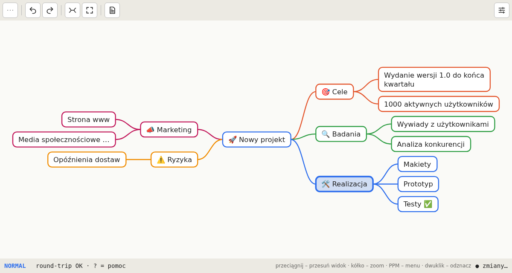

# Mapa myśli

Lekka aplikacja do map myśli, która zapisuje mapy jako zwykłe pliki **Markdown**. Działa w przeglądarce i offline (PWA), na komputerze i na telefonie. Obsługuje mysz, dotyk i klawiaturę, także skróty w stylu **vim**.



- **Plik `.md` jako mapa** – czytelny w każdym edytorze, dobrze współpracuje z gitem i Syncthingiem.
- **Edycja bezpośrednio w węźle**, zawijanie długiego tekstu, emoji.
- **Przeciąganie gałęzi** z animacją: sąsiednie węzły robią miejsce, gałąź „rozciąga się” za kursorem.
- **4 układy**: w prawo, w lewo, na obie strony, w dół; wiele map (korzeni) w jednym pliku.
- **Wygląd każdej mapy**: czcionka, linie, obramowania, wypełnienia, odstępy, 8 palet kolorów. Ustawienia zapisują się w pliku.
- **Bez frameworka i bez budowania** – czysty JavaScript sprawdzany przez TypeScript, testy w Playwright.

## Szybki start

```bash
npx serve www -l 3000
```

Otwórz http://localhost:3000. Przykładową mapę wczytasz z [`docs/przyklad.md`](docs/przyklad.md) (menu `…` → _Otwórz plik…_).

Mapa zapisuje się automatycznie w pamięci przeglądarki. _Zapisz_ (Ctrl+S) zapisuje ją do pliku. W Chrome i Edge zapis trafia bezpośrednio do otwartego pliku, w pozostałych przeglądarkach plik jest pobierany.

## Obsługa

|                      | Mysz                    | Dotyk                                        |
| -------------------- | ----------------------- | -------------------------------------------- |
| zaznacz              | klik                    | stuknięcie                                   |
| edytuj tekst         | dwuklik węzła           | podwójne stuknięcie węzła                    |
| menu podręczne       | prawy przycisk          | przytrzymanie węzła, podwójne stuknięcie tła |
| odznacz              | dwuklik tła             | przytrzymanie tła                            |
| przenieś gałąź       | przeciągnij węzeł       | przeciągnij węzeł                            |
| przesuń widok / zoom | przeciągnij tło / kółko | przeciągnij tło / dwa palce                  |

**Przenoszenie:** węzeł upuszczony na prawej części innego węzła zostaje jego dzieckiem, a upuszczony na lewej górnej lub dolnej części staje się bratem przed nim lub za nim. Esc anuluje przeciąganie, Ctrl+Z cofa przeniesienie.

**Edycja w węźle:** Enter lub Esc zatwierdza, a kolejny Enter dodaje brata. Tab zatwierdza i dodaje dziecko. Ctrl+. albo przycisk 😊 wstawia emoji.

### Klawiatura

Każda czynność ma skrót zwykły i skrót vim:

| Czynność                                   | Zwykły                               | vim                                                   |
| ------------------------------------------ | ------------------------------------ | ----------------------------------------------------- |
| poruszanie (zgodnie z układem)             | strzałki                             | `h` `j` `k` `l` (z licznikiem, np. `3j`)              |
| pierwszy / ostatni węzeł                   | Home / End                           | `gg` / `G`                                            |
| edytuj / od pustego tekstu                 | Spacja                               | `i` lub `e` / `c`                                     |
| brat poniżej / powyżej                     | Enter / Shift+Enter                  | `o` lub `s` / `O` lub `S`                             |
| dziecko                                    | Tab                                  | `a`                                                   |
| duplikuj gałąź (kopia za oryginałem)       | Ctrl+D                               |                                                       |
| kopiuj / wytnij / usuń (bez kopiowania)    | Ctrl+C / Ctrl+X / Del lub Backspace  | `yy` / `dd` / `x`                                     |
| wklej jako dziecko / brata                 | Ctrl+V / Ctrl+Shift+V                | `p` / `P`                                             |
| zwiń / rozwiń                              | Shift+Spacja                         | `za` (wszystko: `zM` / `zR`, do poziomu N: `z1`…`z9`) |
| przesuń, wsuń, wysuń                       | Alt+strzałki (wysuń także Shift+Tab) | `K` `J`, `L`, `H`                                     |
| cofnij / ponów                             | Ctrl+Z / Ctrl+Shift+Z                | `u` / Ctrl+R                                          |
| szukaj, następne, poprzednie               | Ctrl+F, Ctrl+G, Ctrl+Shift+G         | `/`, `n`, `N`                                         |
| dopasuj całą mapę / pokaż zaznaczony węzeł | Shift+1 / Shift+2 (z przybliżeniem)  | `=` / `zz`                                            |
| menu podręczne / odznacz                   | klawisz Menu / Esc                   |                                                       |
| emoji / pomoc                              | Ctrl+. / Ctrl+/                      | `?`                                                   |
| wszystkie polecenia (paleta komend)        | Ctrl+K                               | `:`                                                   |

Gdy nic nie jest zaznaczone, Enter i wklejanie tworzą nową mapę (nowy korzeń).

**Szukanie:** po Ctrl+F pole zostaje otwarte jak w przeglądarce: Enter i Shift+Enter przechodzą do następnego i poprzedniego trafienia, a Esc zamyka pole. Po `/` Enter szuka i zamyka pole jak w vim, a dalej działają `n` i `N`.

**Paleta komend:** Ctrl+K otwiera u góry okienko ze wszystkimi poleceniami, ich skrótami i 5 ostatnio użytymi na początku. Wpisany tekst zawęża listę: słowa można podać w dowolnej kolejności, bez polskich znaków (np. „zw wsz” znajdzie „Zwiń wszystko”). Strzałki wybierają, Enter uruchamia, a Esc zamyka. Na telefonie paletę otwiera menu „…” → „Wszystkie polecenia…”.

`:` otwiera tę samą paletę z wpisanym dwukropkiem, a pełna komenda staje się pierwszą pozycją listy. Komendy: `w`, `e`, `new [tytuł]`, `text`, `fit`, `test`, `layout right|left|both|down`, `export svg|png`, `theme dark|light`. Pełna lista skrótów jest w aplikacji pod Ctrl+/ (albo `?`).

## Format pliku

```markdown
# Pierwsza mapa

<!--layout:both-->
<!--style:{"edgeStyle":"elbow","palette":"Ocean","colors":["#0077b6","#00a6c8","#023e8a","#48cae4","#0096c7","#5e60ce"]}-->

- Gałąź
  - Dziecko
  - Zwinięty węzeł <!--c-->
    - ukryte dziecko

# Druga mapa w tym samym pliku

- …
```

- `# Tytuł` zaczyna mapę. Każdy kolejny nagłówek `#` to osobna mapa (korzeń).
- Węzły to lista `-`, `*` albo `+`. Każde wcięcie o 2 spacje (lub tabulator) oznacza poziom niżej.
- `<!--c-->` na końcu linii oznacza zwinięty węzeł.
- `<!--layout:…-->` i `<!--style:{…}-->` pod pierwszym tytułem zapisują układ i wygląd. W pliku są tylko ustawienia różne od domyślnych.

## Instalacja

### PWA (telefon i komputer)

Opublikuj katalog `www/` przez HTTPS, np. na GitHub Pages lub Netlify. W Chrome lub Edge wybierz _Zainstaluj aplikację_, a na Androidzie _Dodaj do ekranu głównego_. Aplikacja działa wtedy offline.

### Android (APK przez Capacitor)

```bash
npm install
npx cap add android
npm run android          # otwiera Android Studio → Build > Build APK
```

WebView na Androidzie nie ma File System Access API, więc pliki otwiera się przez systemowe okno wyboru, a zapis to pobranie pliku. Bezpośredni zapis wymaga dodania `@capacitor/filesystem`.

### Linux (AppImage przez Tauri)

```bash
npm install
npx tauri init           # frontendDist = ../www, bez serwera deweloperskiego
npm run tauri
```

Wymaga Rusta i `webkit2gtk`.

## Rozwój

```
www/
  index.html, css/app.css    strona i style
  js/*.js                    kod (zwykłe skrypty, ładowane po kolei – opis każdego w 1. linii)
  sw.js, manifest.webmanifest  tryb offline (PWA)
types/globals.d.ts           typy wspólne (węzeł mapy, styl, elementy strony)
tests/*.spec.js              testy Playwright, jeden plik = jeden obszar (opis w tests/README.md)
docs/                        zrzut ekranu i przykładowa mapa
```

| Polecenie        | Co robi                                                                   |
| ---------------- | ------------------------------------------------------------------------- |
| `npm run serve`  | podgląd na http://localhost:3000                                          |
| `npm run check`  | sprawdzanie typów TypeScriptem (JSDoc, tryb `strict`)                     |
| `npm test`       | testy Playwright: Chromium, a skróty klawiszowe także w Firefoksie        |
| `npm run format` | formatowanie (Prettier)                                                   |
| `npm run verify` | typy + formatowanie + wszystkie testy (uruchamiane przed commitem i w CI) |

Pierwsze uruchomienie testów wymaga przeglądarek: `npx playwright install --with-deps chromium firefox`.

**Dlaczego JavaScript, a nie TypeScript?** Aplikacja nie ma etapu budowania: pliki z `www/` działają od razu jako PWA, w Capacitorze i w Tauri. TypeScript sprawdza ten sam kod na podstawie adnotacji JSDoc (`npm run check`), więc korzyści z typów zostają, a kompilacji nie ma.

**Pliki skryptów są zwykłymi skryptami, a nie modułami ES.** Dzielą jeden zakres globalny, więc ich kolejność w `index.html` ma znaczenie. Nowy plik trzeba dopisać także do listy cache w `www/sw.js`. Pilnuje tego test `tests/pwa.spec.js`.

### Kontener (Podman / Docker)

```bash
podman build -t mindmap -f Containerfile .
podman run -it --rm -p 3000:3000 -v "$PWD":/work:Z mindmap bash
# w kontenerze: npm install && npm run verify && npm run serve
```

Opcja `-p 3000:3000` musi być podana przy `run`, bo sam `Containerfile` deklaruje tylko `EXPOSE 3000`.

Wskazówki dla agentów AI (mapa kodu, zasady, znane pułapki) są w [`CLAUDE.md`](CLAUDE.md).

## Licencja

[MIT](LICENSE)
